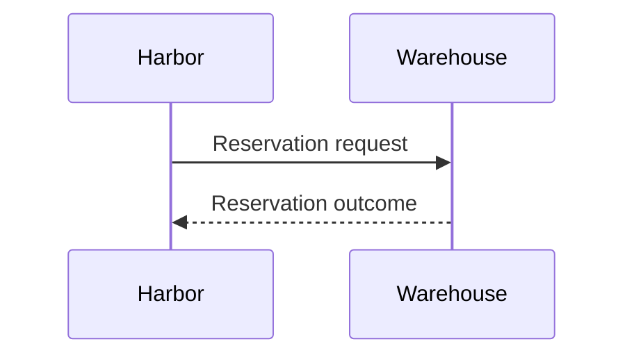

The fixture asserts rendered behavior separately from source fidelity.

---
layout: h-section
routeAlias: catalog-section
title: A supported section
footer: Catalog · section
---

One clear transition to the next question.

---
layout: h-content
routeAlias: catalog-reveals
title: Evidence arrives in order
clicks: 3
footer: Native reveals · initial, intermediate and final states
---

The source begins with an accepted order.

<v-clicks>

- The first reveal keeps the delivery key.
- The second reveal records the attempt.
- The final reveal leaves the decision open.

</v-clicks>

---
layout: h-compare
routeAlias: catalog-compare
title: Keep conditions distinct
footer: Catalog · comparison
---

## Current

The operator retries manually.

::right::

## Proposed

The retry reuses one delivery key.

---
layout: h-visual
routeAlias: catalog-image
title: Reuse an existing image
footer: Catalog · image and explanation
---

This is a proposed flow, not an implemented partner contract.

::visual::

---
layout: h-visual
routeAlias: catalog-mermaid
title: Reuse native Mermaid
footer: Catalog · native diagram
---

The response returns from the warehouse to Harbor.

::visual::

---
layout: h-demo
routeAlias: catalog-local-frame
title: A local interactive boundary
footer: Catalog · local simulation
---

Edit a key and send an attempt.

Escape returns focus to the deck.

::visual::

<HarnessFrame src="/demos/retry/index.html" title="Catalog local retry simulation" fallback="/images/retry-flow.svg" fallback-alt="Stable delivery key across retry attempts" :timeout-ms="1500" />

---
layout: h-demo
routeAlias: catalog-pending-frame
title: A bounded loading state
footer: Catalog · intentional timeout fixture
---

A pending demo must leave the static explanation usable.

::visual::

<HarnessFrame src="/fixture-pending/" title="Intentionally pending demo" fallback="/images/retry-flow.svg" fallback-alt="Static delivery identity flow" :timeout-ms="300" />

---
layout: h-demo
routeAlias: catalog-denied-frame
title: A denied frame
footer: Catalog · intentional framing failure
---

Framing uncertainty is visible; the fallback remains available.

::visual::

<HarnessFrame src="/fixture-denied/" title="Intentionally denied demo" fallback="/images/retry-flow.svg" fallback-alt="Static delivery identity flow" :timeout-ms="300" />

---
layout: h-demo
routeAlias: catalog-external-frame
title: An external verification limit
footer: Catalog · different origin, controlled local server
---

Loading an external document does not verify its interactions.

::visual::

<HarnessFrame src="CROSS_ORIGIN_FIXTURE" title="Controlled cross-origin demo" fallback="/images/retry-flow.svg" fallback-alt="Static delivery identity flow" :timeout-ms="1500" />
