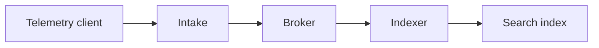

Separate telemetry intake from indexing while keeping the migration reversible.

Delivery semantics and operational ownership remain open.

---
layout: h-section
routeAlias: architecture-context
title: One handler owns both steps
footer: Current behavior · sources/architecture.md
---

Atlas receives telemetry and writes its searchable index in one handler.

A failed index write fails that request.

---
layout: h-compare
routeAlias: architecture-options
title: Decouple acceptance and indexing
footer: Current versus proposed
---

## Current

One handler receives and indexes each event.

The request waits for the index write.

::right::

## Proposed

Intake publishes accepted events to a broker.

An indexer consumes them independently.

---
layout: h-visual
routeAlias: architecture-boundary
title: A broker creates a new boundary
footer: Proposed architecture · no delivery guarantee assumed
---

Intake and indexing can recover independently.

Ordering, retention and delivery semantics need a decision.

::visual::

---
layout: h-content
routeAlias: architecture-migration
title: Preserve a reversible path
clicks: 3
footer: Proposed phases · no migration dates
---

Move the boundary only after the event contract is agreed.

<v-clicks>

- Define acceptance and replay semantics.
- Exercise broker-to-index recovery with synthetic events.
- Decide rollback and ownership before switching intake.

</v-clicks>

---
layout: h-compare
routeAlias: architecture-tradeoffs
title: Independence adds operating work
footer: Tradeoffs · benefits are hypotheses, not measured results
---

## Opportunity

Recover indexing without coupling every client request to it.

::right::

## Cost and uncertainty

Operate a broker and make replay, ordering and ownership explicit.

---
layout: h-content
routeAlias: architecture-decision
title: Resolve semantics before choosing a broker
footer: Requested decision · synthetic example
---

Agree acceptance, ordering, retention and operating ownership.

No broker product, performance target or delivery date is selected.
