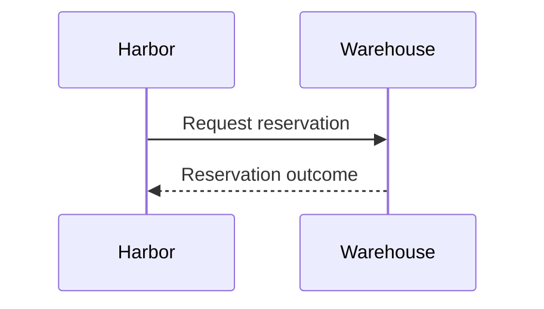

Introduce an explicit reservation response between Harbor and the warehouse.

The warehouse contract remains under discussion.

---
layout: h-section
routeAlias: integration-context
title: Availability is not a reservation
footer: Current behavior · sources/integration.md
---

Harbor reads warehouse availability before accepting a cart.

The current response does not hold stock for that cart.

---
layout: h-compare
routeAlias: integration-contract
title: Separate availability from commitment
footer: Current versus proposed
---

## Current

Harbor receives an availability result.

Another cart may consume that stock.

::right::

## Proposed

Harbor requests a reservation before acceptance.

The warehouse returns an explicit reservation outcome.

---
layout: h-visual
routeAlias: integration-sequence
title: Request an explicit outcome
footer: Proposed boundary · timeout behavior is unresolved
---

A reservation result gates acceptance.

The source does not define a timeout or cancellation contract.

::visual::

---
layout: h-content
routeAlias: integration-phases
title: Validate the boundary in stages
footer: Proposed phases · no delivery dates
---

1. Agree success and rejection responses.
2. Decide timeout and cancellation semantics.
3. Validate both sides with representative carts.

---
layout: h-compare
routeAlias: integration-decisions
title: Settle failure semantics
footer: Unresolved decisions · no invented contract values
---

## Risk

A timeout can leave Harbor unsure whether stock was reserved.

::right::

## Decision needed

How can Harbor query or cancel an uncertain reservation?

---
layout: h-content
routeAlias: integration-close
title: Agree the contract before rollout
footer: Requested next step
---

Review the warehouse response and recovery contract together.

No SLA, rollout date or reservation lifetime is specified yet.
